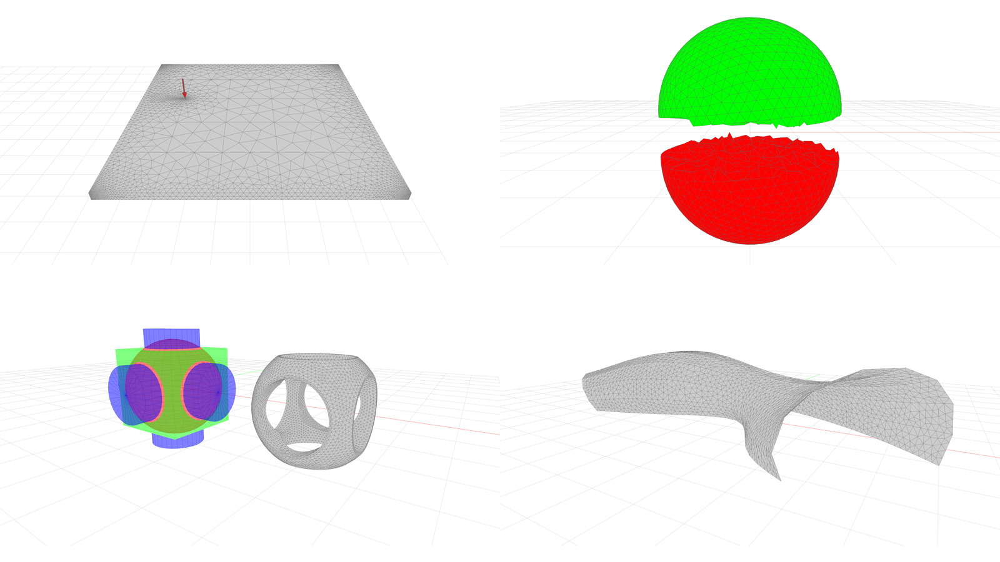

# COMPAS Gmsh

`compas_gmsh` is a typed, COMPAS-friendly wrapper around the official
[Gmsh](https://gmsh.info/) Python SDK. Gmsh is a finite-element mesh generator
with a built-in CAD engine and post-processor.

The package supports:

- planar and solid mesh generation;
- conversion of Gmsh meshes to COMPAS data structures;
- OCC primitive construction and boolean operations;
- STEP import, including temporary STEP exchange from a COMPAS BRep; and
- direct access to the underlying Gmsh model, mesh, and OCC APIs for advanced workflows.

All automated runtime checks are headless. The wrapper does not open the Gmsh
GUI or bundle the Gmsh SDK.
